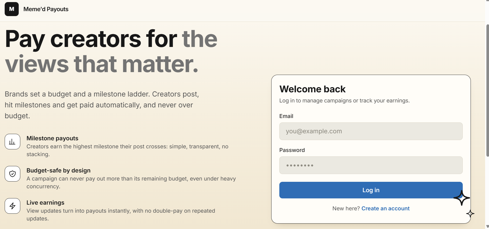
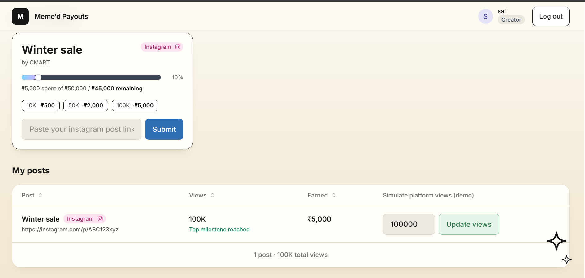
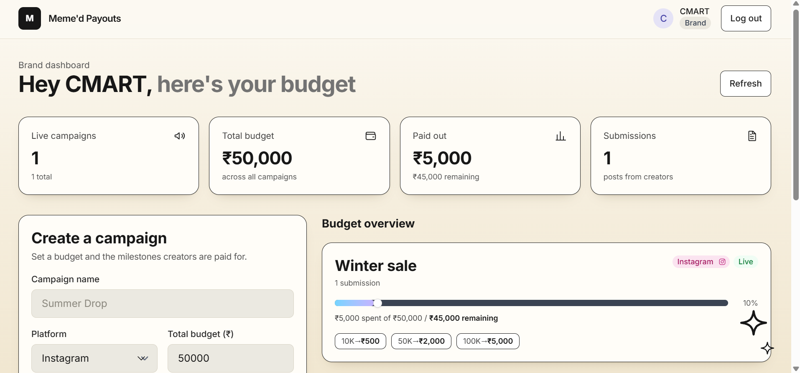

# Meme'd Campaign Payout Tracker

Creator marketplace app: brands create campaigns with a budget and a milestone ladder; creators submit posts and earn the highest milestone their post has crossed, never exceeding the campaign budget.

## Live Links
- **Frontend (Vercel):** https://memed-payout-tracker-ochre-eight.vercel.app
- **Backend (Render):** https://memed-payout-tracker-9aly.onrender.com (health check: [/health](https://memed-payout-tracker-9aly.onrender.com/health))

> The backend is on Render's free tier, so the first request after idle can take ~50 seconds (cold start). Open the `/health` link once to wake it before testing.

## Submission Checklist
| Requirement | Where |
|---|---|
| Public GitHub repo, monorepo with `/backend` and `/frontend` | [Project Structure](#project-structure) |
| README with setup steps | [Setup (local)](#setup-local-without-docker) and [Run with Docker](#run-with-docker) |
| Environment variable info | [Environment Variables](#environment-variables) |
| Assumptions made | [Assumptions (open cases)](#assumptions-open-cases) |
| Sample `.env.example` | [`backend/.env.example`](backend/.env.example) and [`frontend/.env.example`](frontend/.env.example) |
| Deployed live link | [Live Links](#live-links) |

## Screenshots

### Login


### Creator dashboard


### Brand dashboard


## Tech Stack
- Backend: Node.js, TypeScript, Express, MongoDB (Mongoose), JWT, Zod, Jest
- Frontend: Next.js (App Router), TypeScript
- Infra: Docker + docker-compose; MongoDB Atlas, Render, Vercel for deployment
- Optional: Redis cache for the live campaigns list (disabled when `REDIS_URL` is unset)

## Project Structure
```
/backend    Express API, models, payout engine, Jest tests
/frontend   Next.js app (login, signup, brand and creator dashboards)
/docs       Scaling note and screenshots
docker-compose.yml
```

## Setup (local, without Docker)
Requires Node 20+ and a MongoDB instance (Atlas free tier or local).

```bash
# Backend
cd backend
cp .env.example .env   # fill in values
npm install
npm run dev            # http://localhost:4000
npm test

# Frontend
cd frontend
cp .env.example .env.local
npm install
npm run dev            # http://localhost:3000
```

## Run with Docker
Runs MongoDB, Redis, the backend and the frontend with one command. No Atlas account needed locally.

```bash
docker compose up --build
```

- Frontend: http://localhost:3000
- Backend API: http://localhost:4000/api
- Data persists in the `mongo_data` volume. `docker compose down -v` wipes it.

Notes:
- If ports 3000 or 4000 are already in use, stop whatever is using them or change the host port (left side of the mapping) in `docker-compose.yml`. If you change the frontend port, also update `CORS_ORIGIN` to match.
- `NEXT_PUBLIC_API_URL` is baked into the frontend at build time, so changing it requires `docker compose up --build`.
- The browser calls the backend at `localhost:4000`; only the backend talks to Mongo and Redis through the internal service names `mongo` and `redis`.
- Compose uses local Mongo and Redis containers. Production uses Atlas, and runs without Redis unless `REDIS_URL` is set.

## Environment Variables
Copy `.env.example` to `.env` (backend) or `.env.local` (frontend).

| Variable | Where | Required | Description |
|---|---|---|---|
| NODE_ENV | backend | No | `development`, `test` or `production` (default `development`) |
| PORT | backend | No | Server port (default `4000`) |
| MONGO_URI | backend | Yes | MongoDB connection string |
| JWT_SECRET | backend | Yes | Secret used to sign JWTs (min 16 characters) |
| JWT_EXPIRES_IN | backend | No | Token lifetime (default `7d`) |
| CORS_ORIGIN | backend | No | Allowed frontend origin(s), comma-separated, no trailing slash (default `http://localhost:3000`) |
| REDIS_URL | backend | No | Enables the live campaigns cache when set |
| NEXT_PUBLIC_API_URL | frontend | No | Backend base URL **including `/api`** (default `http://localhost:4000/api`) |

The backend validates env vars with Zod at startup and exits with a clear message if a required one is missing.

### Sample `.env.example`
`backend/.env.example`
```env
NODE_ENV=development
PORT=4000
MONGO_URI=mongodb://localhost:27017/memed
JWT_SECRET=replace-with-a-long-random-string
JWT_EXPIRES_IN=7d
CORS_ORIGIN=http://localhost:3000
# REDIS_URL=redis://localhost:6379   # optional
```

`frontend/.env.example`
```env
NEXT_PUBLIC_API_URL=http://localhost:4000/api
```

## How Payouts Work
`calculatePayout(views, ladder, alreadyPaid, remainingBudget) -> { payout, newTotalPaid }`

1. Find the highest milestone whose threshold the views have reached.
2. Payout is that milestone's amount minus `amountPaid` (never negative).
3. Payout is capped at the campaign's remaining budget.

Overspend protection under concurrency (`views.service.ts`):
- **Reserve:** budget is deducted with an atomic `findOneAndUpdate` on the campaign that only succeeds while `budgetSpent + delta <= totalBudget`.
- **Credit:** the submission is updated conditionally (`amountPaid` must still equal the value that was read), so duplicate or parallel updates cannot double-pay. If the credit misses, the reservation is released and the update is retried.
- **Failure mode:** if the process dies between the two steps, the campaign can under-spend but never overspend. It is reconcilable by comparing `budgetSpent` with the sum of `amountPaid`.

## Caching
`GET /api/campaigns` (the shared live list) is cached in Redis for 30 seconds. The cache is cleared when a campaign is created and whenever a payout changes a campaign's budget, so creators never see a stale "remaining" amount or an exhausted campaign. Cache helpers fail open: if Redis is unset or down, requests fall back to MongoDB.

## Assumptions (open cases)
| Open question | Decision |
|---|---|
| Post crosses 2 milestones in one update | Pay the highest milestone's amount in total (no stacking); pay only the difference from what was already paid |
| Views go down | Never claw back; payout is monotonic |
| Same update sent twice | No double pay; track `amountPaid` per submission and pay `milestoneAmount - amountPaid` |
| Budget runs out mid-payout | Pay the partial remaining amount; campaign is then exhausted |
| Campaign has 0 budget left | Hidden from the live campaigns list |
| Ladder validation | Thresholds unique and ascending, payouts increasing, all positive |

## API Reference
All routes except `/health` and auth require `Authorization: Bearer <token>`.

| Method | Path | Role | Description |
|---|---|---|---|
| GET | `/health` | Public | Health check |
| POST | `/api/auth/signup` | Public | Create a brand or creator account |
| POST | `/api/auth/login` | Public | Log in, returns a JWT |
| POST | `/api/campaigns` | Brand | Create a campaign with budget and ladder |
| GET | `/api/campaigns/mine` | Brand | Own campaigns with spent vs remaining budget |
| GET | `/api/campaigns` | Creator | Live campaigns (budget remaining) |
| POST | `/api/campaigns/:id/submissions` | Creator | Submit a post link to a campaign |
| PATCH | `/api/submissions/:id/views` | Creator | Update views and trigger the payout calculation |
| GET | `/api/creators/me/earnings` | Creator | Total earnings across submissions |

Errors are returned as JSON with a consistent shape from the central error handler.

## Testing
```bash
cd backend
npm test
```
Covers payout calculation (below, on and across thresholds, multi-milestone jumps, repeat calls, decreasing views), the budget cap, partial payouts, idempotency and concurrent updates.

## Deployment
- **Database:** MongoDB Atlas (network access allows `0.0.0.0/0` because Render's free tier has no fixed IP).
- **Backend:** Render web service, root directory `backend`.
  - Build: `npm install --include=dev && npm run build` (`--include=dev` is needed because `NODE_ENV=production` would otherwise skip TypeScript).
  - Start: `npm start`.
  - Env: `NODE_ENV`, `MONGO_URI`, `JWT_SECRET`, `JWT_EXPIRES_IN`, `CORS_ORIGIN` (optionally `REDIS_URL`, e.g. from Upstash).
- **Frontend:** Vercel, root directory `frontend`, `NEXT_PUBLIC_API_URL` set to the Render URL plus `/api`.
- Set backend `CORS_ORIGIN` to the Vercel URL(s), comma-separated.

## Scaling
See [docs/SCALING.md](docs/SCALING.md).